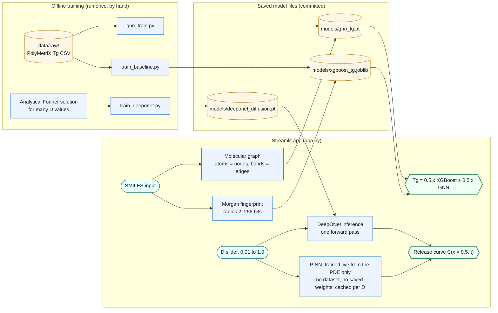

# Polymer Tg Predictor

[](https://github.com/CherryRambler/Polymer-Tg-Predictor/actions/workflows/tests.yml)
[](https://polymer-tg-predictor-8vh4dgb7geuxqwqkgyxqmg.streamlit.app/)

Predicts a polymer's glass transition temperature (Tg) from its SMILES string
with an XGBoost + graph-neural-network ensemble, with an honest uncertainty
interval, and simulates diffusion-driven drug release with a physics-informed
neural network (PINN) and a neural operator (DeepONet).

**Live demo:** [polymer-tg-predictor-8vh4dgb7geuxqwqkgyxqmg.streamlit.app](https://polymer-tg-predictor-8vh4dgb7geuxqwqkgyxqmg.streamlit.app/)

<!-- TODO: add a screenshot of the app here as docs/screenshot.png
     (Playwright was not available when this README was written):

-->

## What it does

- **Tg from structure.** XGBoost on Morgan fingerprints plus a GNN on the
  atom/bond graph, averaged 50/50, trained on 7,363 real polymers.
- **Uncertainty you can check.** A split-conformal interval built from
  out-of-sample errors, plus warnings when the two models disagree or the
  polymer is unlike the training data.
- **Drug-release curves.** Fick's second law on a slab, solved by a PINN that
  trains live in the app from the equation alone (no data), and by a DeepONet
  trained once offline that answers instantly for any D.
- **Validated against exact answers.** Both networks are scored against the
  closed-form solution, including D values never seen in training.

The diffusion coefficient D is **set by you with a slider**. It is not
predicted from the polymer, and the release curves are illustrative, not
measured drug-release data.

## Key results

Tg (°C). Lower MAE is better. A random split lets near-identical polymers land
in both train and test, while a **scaffold split** keeps every ring framework
(Murcko scaffold) entirely in train or entirely in test, which makes it the
more honest test for new chemistry.

| Tg model | Random split: MAE / R² | Scaffold split: MAE / R² |
|---|---|---|
| XGBoost, Morgan fingerprints (5-fold CV, 7,363 polymers) | 27.5 / 0.871 | **36.3 / 0.795** |
| XGBoost, same 737 test polymers as the GNN | 29.3 / 0.836 | – |
| GNN, molecular graph (737 test polymers) | 28.5 / 0.830 | not measured |
| **Ensemble, 50/50** (737 test polymers) | **26.1 / 0.859** | not measured |

- **Interval:** the 90% interval is ±53 °C. On 369 held-out polymers not used
  to set it, it contained the true Tg **88.3%** of the time. That interval is
  calibrated on the random split: on XGBoost's scaffold-split errors the same
  ±53 °C covers only **78%**.
- **Warnings:** when XGBoost and the GNN disagree by more than 51 °C, held-out
  error is 43.9 °C vs 25.1 °C otherwise. When the most similar training
  polymer has Tanimoto similarity below 0.58, it is 56.7 °C vs 24.0 °C.
- **Scaffold split, model size:** 36.3 °C uses the deployed XGBoost settings
  (400 trees, depth 8). An earlier smaller model (200 trees, depth 5) gave
  39.7 °C / R² 0.772.

Diffusion (concentration C is between 0 and 1). Errors are against the exact
solution, excluding the single corner where the initial and boundary
conditions contradict each other.

| Diffusion model | Result |
|---|---|
| PINN, D = 0.1, full training (5,000 Adam epochs + 10 L-BFGS rounds) | MAE 0.0062, max error 0.062 |
| DeepONet, 12 unseen D values inside the trained range 0.01–1.0 | MAE 0.0048, R² 0.999, worst D 0.0081 |
| DeepONet, 6 unseen D values outside the trained range | MAE 0.0255, worst (D = 0.003) 0.071 |

SPEED_RESULTS_PLACEHOLDER

**Where the numbers come from:**

- `results/cv_predictions.csv`: XGBoost random split.
- `results/scaffold_split_metrics.json`: scaffold split.
- `results/gnn_evaluation.json`: GNN and ensemble, from the committed `models/gnn_tg.pt`.
- `results/uncertainty.json`: interval and warnings.
- `results/pinn_evaluation.json`: PINN.
- `results/deeponet_evaluation.json`: DeepONet.
- `results/speed_benchmark.json`: speed.

**Seeds:** the XGBoost CV and the GNN split use seed 42, the conformal split
seed 0, and DeepONet training seed 0. The GNN's weight initialisation is not
seeded, so retraining it moves its MAE by about 1 °C (an earlier run gave
29.6 °C).

## Architecture



Cylinders are stored files (data and model weights); rectangles are code.
The same SMILES feeds both Tg models. D comes **only** from the slider. The
PINN has no training data and no saved weights. It is trained inside the
app, from the diffusion equation alone, whenever you tick its box, and the
result is cached per D.

A more detailed diagram, with every script and evaluation step, is in
[docs/architecture.svg](docs/architecture.svg). It is generated: edit
`docs/gen_architecture.py`, then run `python docs/gen_architecture.py`.

## Quickstart

You need Python 3.12 (the version used for deployment). The data and the
trained models the app uses are already in the repository, so nothing needs
downloading or training.

```bash
git clone https://github.com/CherryRambler/Polymer-Tg-Predictor.git
cd Polymer-Tg-Predictor
python -m venv .venv
# Windows:      .venv\Scripts\activate
# macOS/Linux:  source .venv/bin/activate
pip install -r requirements.txt
streamlit run app.py          # opens the app at http://localhost:8501
pytest tests/ -v              # the same tests CI runs on every push
```

`requirements.txt` installs the CPU-only PyTorch build (through the PyTorch
extra index), plus RDKit, scikit-learn, XGBoost, PyTorch Geometric, Streamlit
and pytest. `packages.txt` lists the system libraries (`libxrender1`,
`libxext6`, `libsm6`) that RDKit's molecule drawing needs on Streamlit Cloud.

### Reproduce the results (optional)

Run these from the project root. Each script states its inputs and outputs at
the top.

```bash
# Data (OPTIONAL: data/raw/ is already committed). Only needed to rebuild it from
# the source file, which you must first download by hand from Zenodo (its
# automatic download often times out):
#   https://zenodo.org/records/14980914/files/LAMALAB_CURATED_Tg_structured.csv?download=1
#   saved as data/raw/LAMALAB_CURATED_Tg_structured.csv
python src/phase1_baseline/get_data.py              # source CSV -> data/raw/polymer_tg_polymetrix.csv
python src/phase1_baseline/filter_reliable_data.py  # drop the 4 'red' (conflicting) entries

# Checks and features
python src/phase1_baseline/validate_data.py         # every SMILES parses
python src/phase1_baseline/featurize.py             # -> data/processed/featurized.csv

# Phase 1: XGBoost (also writes a 92 MB random forest that is not committed)
python src/phase1_baseline/train_baseline.py        # 5-fold CV -> results/cv_predictions.csv
python src/phase1_baseline/plot_results.py
python src/phase1_baseline/inspect_worst_predictions.py
python src/phase1_baseline/scaffold_split_eval.py   # -> results/scaffold_split_*.{json,csv}

# Phase 2: GNN
python src/phase2_gnn/gnn_data.py                   # -> data/processed/graph/polymer_graphs.pt
python src/phase2_gnn/gnn_train.py                  # overwrites models/gnn_tg.pt
python src/phase2_gnn/gnn_evaluate.py               # committed GNN + ensemble -> results/gnn_evaluation.json
python src/analysis/compare_phase1_vs_gnn.py
python src/analysis/ensemble.py
python src/analysis/learned_ensemble.py             # blend-weight search (50/50 is best)
python src/analysis/uncertainty.py                  # -> results/uncertainty.json

# Phase 3: PINN
python src/phase3_pinn/pinn_train.py                # D = 0.1 -> models/pinn_diffusion.pt (not committed)
python src/phase3_pinn/pinn_evaluate.py             # -> results/pinn_evaluation.json

# Phase 4: DeepONet
python src/phase4_neural_operator/train_deeponet.py     # overwrites models/deeponet_diffusion.pt
python src/phase4_neural_operator/deeponet_evaluate.py  # -> results/deeponet_evaluation.json
python src/phase4_neural_operator/deeponet_compare.py   # before/after table (trains 3 recipes)
python src/phase4_neural_operator/speed_benchmark.py    # -> results/speed_benchmark.{json,png}
```

## How each part works

**Data.** The PolyMetriX curated Tg dataset has 7,367 polymers with repeat-unit
SMILES and experimental Tg. Each entry has a reliability flag. "Black" (96% of
rows) means single-source, not wrong, so it is kept. Only the 4 "red" rows
(conflicting values across sources) are dropped, leaving 7,363.

**Tg models.** XGBoost uses a 256-bit Morgan fingerprint (radius 2). The GNN
(GINEConv) reads the molecular graph directly: atoms are nodes (element,
degree, aromaticity, charge) and bonds are edges (bond type, ring
membership). The app shows their 50/50 average. A search over blend weights
(`learned_ensemble.py`) found 50/50 to be the best. The ensemble beats either
model alone because their errors partly cancel.

**Uncertainty** (`src/analysis/uncertainty.py`). The 737 polymers held out from
the GNN also have out-of-fold XGBoost predictions, so their ensemble errors
are genuinely out-of-sample. Half (368) set the interval: it is the
ceil((n + 1) × 0.9)-th smallest absolute error, the finite-sample conformal
rule. The other half (369) measure its real coverage. Both warning thresholds
come from the first half and are checked on the second.

**Diffusion problem.** Fick's second law, dC/dt = D d²C/dx², on a slab
0 ≤ x ≤ 1 for 0 ≤ t ≤ 5. The initial condition is C = 1 everywhere, and the
boundary condition holds C at 0 on both faces. The exact answer is a Fourier
series (`src/phase3_pinn/pinn_analytical.py`). All units are dimensionless.

**PINN** (`src/phase3_pinn/`). A small tanh network maps (x, t) to C. It is
trained only on the physics: the PDE residual (through automatic
differentiation) plus the initial and boundary conditions. Training uses Adam
then L-BFGS, resampling points between L-BFGS rounds to avoid overfitting one
fixed point set. One network covers one value of D.

**DeepONet** (`src/phase4_neural_operator/`). It learns the whole map
(D, x, t) → C: a branch net encodes D and a trunk net encodes (x, t). Its
training data are exact solutions, not PINN outputs, so it doesn't inherit
PINN error. The deployed recipe (`train_deeponet.py --config improved`, seed 0):

- 200 D values sampled log-uniformly from 0.01 to 1.0.
- log₁₀ D fed to the branch net.
- Time points packed toward t = 0, where the solution changes fastest.
- Exact labels at t = 0.
- 1,500 Adam epochs.

Compared with the first recipe it cut held-out error about 4×. The full
before/after table is in `results/deeponet_before_after.md`.

## Project structure

```text
Polymer-Tg-Predictor/
├── app.py                       # Streamlit web app (deployed)
├── data/raw/                    # PolyMetriX Tg data (committed)
├── docs/                        # detailed architecture diagram + its generator
├── models/                      # the three model files the app loads (others are gitignored)
├── results/                     # every metric quoted in this README, plus plots
├── src/
│   ├── phase1_baseline/         # data prep, fingerprints, XGBoost, scaffold split
│   ├── phase2_gnn/              # graph neural network
│   ├── phase3_pinn/             # physics-informed neural network + exact solution
│   ├── phase4_neural_operator/  # DeepONet, its evaluation and the speed benchmark
│   └── analysis/                # ensemble, blend-weight search, uncertainty
├── tests/                       # pytest suite (also run by GitHub Actions)
├── .github/workflows/tests.yml  # CI: runs the tests on every push and pull request
├── requirements.txt             # Python dependencies (CPU-only PyTorch)
└── packages.txt                 # system packages for Streamlit Cloud
```

## Limitations

- **D is not a drug diffusivity.** It is a dimensionless number you choose
  with a slider, and the release curve is illustrative. Nothing in this
  project predicts D from polymer structure, and the app does not use a
  permeability-derived proxy for D.
- **Small, mostly single-source dataset.** It has about 7.4k polymers
  (7,363), and 96% of the Tg values come from a single unverified source.
  A few predictions are off by 150–300 °C. These are mostly unusual
  structures (rare ring systems, uncommon atoms like Se), and a few look like
  label errors (e.g. `polymer_5771`: both models predict 340–490 °C against a
  recorded 25 °C; not independently verified).
- **Scores drop on new chemistry.** XGBoost's MAE rises from 27.5 °C
  (random split) to 36.3 °C (scaffold split). The GNN and the ensemble have
  not been scaffold-tested. The interval is calibrated on the random split
  and covers only 78% of XGBoost's scaffold-split errors, so for novel
  structures it is too narrow (the app says so).
- **PINN corner conflict.** At x = 0 (or 1) and t = 0 the initial condition
  (C = 1) and boundary condition (C = 0) contradict each other, so no smooth
  network can match both. The error there reaches 0.99. All PINN and
  DeepONet errors above exclude points with t ≤ 0.05 and x < 0.03 or
  x > 0.97. The PINN trained in the app uses a shorter schedule than the
  validated one (see the speed section for its accuracy).
- **DeepONet weaknesses.**
  - Its error grows outside the trained D range (MAE 0.071 at D = 0.003,
    about 9× its worst in-range D).
  - It is not constrained to stay in [0, 1]. On the app's curve, 40% of
    points dip below 0 late in the release, but the worst is only −0.007,
    and 0.5% exceed 1 (worst 1.009).
  - It only knows this one slab geometry and set of conditions.
  - Its branch net sees a single number (D), so it is a parametric
    surrogate rather than an operator over general input functions.
- **The closed form wins here.** For this simple geometry, the exact series
  is both faster and more accurate than either network. The networks are
  here to show the method, which matters for problems with no closed-form
  solution.

## Next steps

- Scaffold-split evaluation of the GNN and the ensemble, and an interval
  calibrated on that split.
- Seed the GNN's weight initialisation so retraining is exactly reproducible.
- Enforce 0 ≤ C ≤ 1 in the DeepONet (e.g. a bounded output layer).
- Link structure to diffusion properly, with a measured diffusion-coefficient
  dataset.
- Add a screenshot and a Docker setup.
